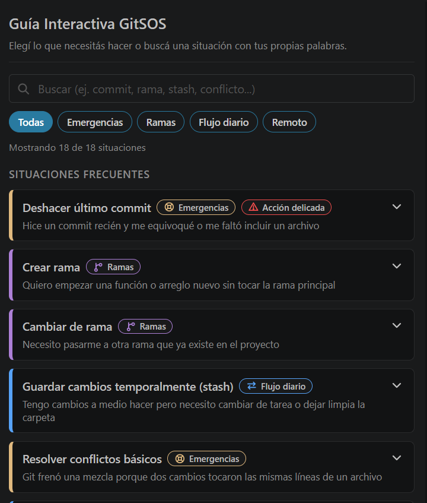
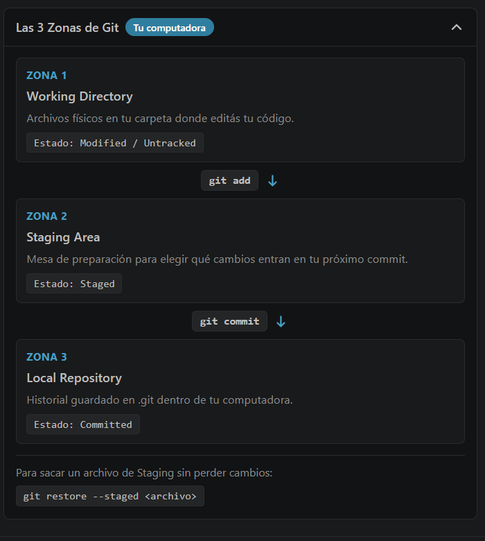
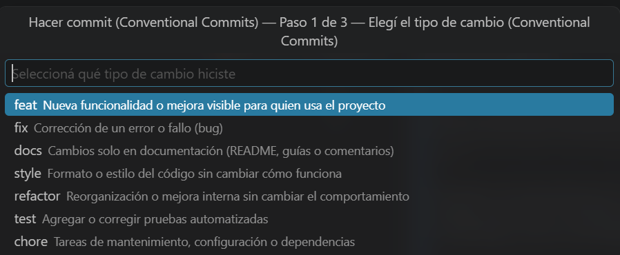
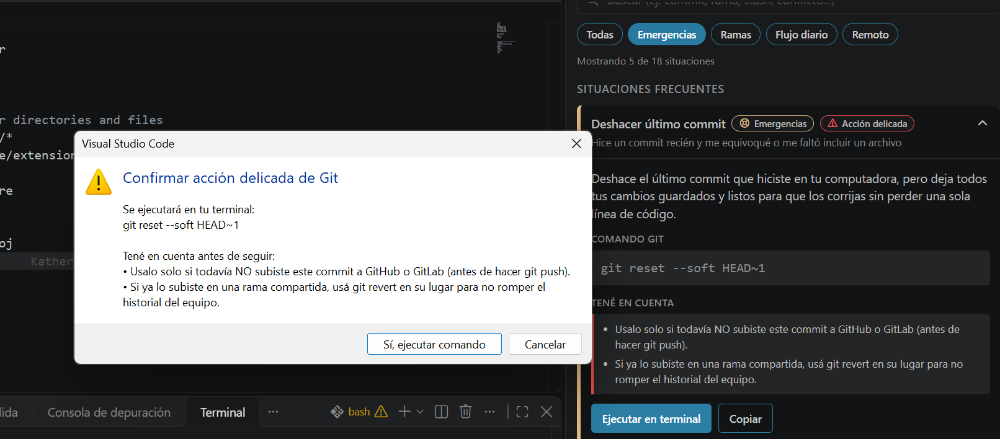

<p align="center">
  
</p>

# GitSOS — Guía Interactiva de Git y GitHub para Principiantes

**GitSOS** es una extensión gratuita, comunitaria y **100% offline** para Visual Studio Code diseñada para personas que recién empiezan con Git y GitHub. Explica qué hace cada comando en español simple, te pide los datos necesarios paso a paso y pide confirmación antes de ejecutar acciones delicadas.

- Sitio web y guía completa: [https://git-sos.vercel.app/](https://git-sos.vercel.app/)
- Código fuente: [https://github.com/KLGomez/GitSOS](https://github.com/KLGomez/GitSOS)

---

## ¿Qué podés hacer con GitSOS?

- **Panel lateral interactivo (Activity Bar):** buscá situaciones cotidianas o errores por título, descripción o comando, filtrá por categoría (`Emergencias`, `Flujo diario`, `Ramas`, `Remoto`) y consultá el diagrama visual de **Las 3 Zonas de Git** (*Working Directory* → *Staging Area* → *Local Repository*) sin conexión a internet.
- **Selector rápido (`GitSOS: ¿Qué necesito hacer?`):** abrí la Paleta de Comandos (`Ctrl+Shift+P` / `Cmd+Shift+P`) y elegí lo que te pasó en lenguaje cotidiano.
- **Comandos directos en la paleta:** accesos rápidos para las situaciones clave (deshacer último commit, crear rama, cambiar de rama, stash y resolver conflictos).
- **Ejecución guiada y segura:** antes de tocar tu repositorio, GitSOS muestra qué hace el comando, pide los datos faltantes (`showInputBox` con validación), exige confirmación modal en acciones delicadas y ejecuta todo en una terminal integrada dedicada (`GitSOS`). Los flujos con varios pasos (como `add` + `commit`) se envían línea por línea sin operadores dependientes de shell (`&&` / `;`), funcionando igual en PowerShell, CMD, Bash y Zsh.
- **Asistente guiado de Conventional Commits en español:** al confirmar cambios (`hacer-commit` o el atajo `guardar-cambios`), GitSOS te guía en 3 pasos —tipo (`feat`, `fix`, `docs`, `style`, `refactor`, `test`, `chore`), alcance opcional y descripción—, arma `tipo(scope): mensaje` o `tipo: mensaje`, escapa comillas dobles y avisa sin bloquear si el mensaje empieza con mayúscula, termina en punto o supera 72 caracteres.
- **Accesible y adaptable:** compatible con temas claro, oscuro y alto contraste de VS Code, navegable completamente con teclado.

---

## Capturas

### Panel lateral interactivo y filtros por categoría


Panel lateral interactivo 100% offline con buscador, filtros por categoría (`Emergencias`, `Ramas`, `Flujo diario` y `Remoto`) y etiquetas visuales accesibles.

### Diagrama de Las 3 Zonas de Git


Diagrama visual offline de Las 3 Zonas de Git para entender el paso de tus archivos desde Working Directory hacia Staging Area y Local Repository.

### Asistente guiado de Conventional Commits


Asistente guiado en 3 pasos para armar mensajes de Conventional Commits en español eligiendo tipo, alcance opcional y descripción.

### Confirmación modal de acciones delicadas


Confirmación modal obligatoria que muestra el comando exacto y advertencias antes de ejecutar acciones delicadas en la terminal integrada.

---

## Situaciones incluidas (18 en v0.2.3)

| Categoría | Situación | Comando Git | Acción delicada |
| :--- | :--- | :--- | :---: |
| **Emergencias** | Deshacer último commit | `git reset --soft HEAD~1` | Sí |
| **Emergencias** | Corregir mensaje del último commit | `git commit --amend -m "..."` | Sí |
| **Emergencias** | Descartar cambios de un archivo | `git restore -- <archivo>` | Sí |
| **Emergencias** | Dejar de rastrear un archivo (`.env`) | `git rm --cached -- <archivo>` | Sí |
| **Emergencias** | Resolver conflictos básicos | `git status` *(con guía paso a paso)* | No |
| **Flujo diario** | Ver qué está pasando ahora | `git status` | No |
| **Flujo diario** | Ver diferencias antes de guardar | `git diff` | No |
| **Flujo diario** | Preparar mis cambios (`add`) | `git add .` | No |
| **Flujo diario** | Hacer commit (Conventional Commits) | `git commit -m "..."` | No |
| **Flujo diario** | Guardar mis cambios (atajo `add` + `commit`) | `git add .` → `git commit -m "..."` | No |
| **Flujo diario** | Ver el historial de commits | `git log --oneline` | No |
| **Flujo diario** | Guardar cambios temporalmente (`stash`) | `git stash` | No |
| **Flujo diario** | Recuperar cambios del stash | `git stash pop` | No |
| **Ramas** | Crear rama | `git switch -c <rama>` | No |
| **Ramas** | Cambiar de rama | `git switch <rama>` | No |
| **Remoto** | Clonar un repositorio | `git clone <url>` | No |
| **Remoto** | Traer cambios de la nube | `git pull` | No |
| **Remoto** | Subir mis cambios a la nube | `git push` | No |

---

## Instalación

### Desde Visual Studio Marketplace / Open VSX
Buscá **GitSOS** (ID: `klgomez.gitsos`) en la vista de Extensiones de VS Code (`Ctrl+Shift+X`), o ejecutá:
```bash
code --install-extension klgomez.gitsos
```

### Desde un archivo `.vsix` local
1. Descargá o generá el archivo `gitsos-0.2.3.vsix`.
2. En VS Code, abrí la vista de **Extensiones** (`Ctrl+Shift+X`), hacé clic en el menú `...` → **Install from VSIX...** (o ejecutá `code --install-extension gitsos-0.2.3.vsix`).

---

## Uso rápido

1. Hacé clic en el ícono de **GitSOS** en la barra lateral izquierda (Activity Bar) para abrir la **Guía interactiva**.
2. Usá el buscador o los filtros de categoría para encontrar tu situación, desplegá la tarjeta y elegí **Copiar** o **Ejecutar en terminal**.
3. También podés abrir la Paleta de Comandos (`Ctrl+Shift+P`) y ejecutar **`GitSOS: ¿Qué necesito hacer?`** o cualquiera de los comandos individuales de GitSOS.

---

## ¿Qué son los Conventional Commits?

Un *commit* es una foto de tu proyecto en un momento. Los **Conventional Commits** son una forma de escribir el mensaje de cada commit para que cualquiera (incluyéndote a vos en seis meses) entienda de un vistazo **qué se hizo**.

El formato es:

```
tipo(alcance): descripción
```

- **tipo:** qué clase de cambio es.
- **alcance** *(opcional)*: qué parte del proyecto tocaste, por ejemplo `login` o `ui`.
- **descripción:** qué hiciste, corta y en minúscula.

### Los tipos que usa GitSOS

| Tipo | Cuándo usarlo | Ejemplo |
| :--- | :--- | :--- |
| `feat` | Agregaste una función nueva | `feat(login): agregar botón de ingreso` |
| `fix` | Arreglaste un error | `fix: corregir ruta de archivos` |
| `docs` | Cambiaste solo documentación | `docs: actualizar instrucciones del README` |
| `style` | Formato o espacios, sin cambiar la lógica | `style: ordenar imports` |
| `refactor` | Reorganizaste código sin cambiar lo que hace | `refactor(api): simplificar validaciones` |
| `test` | Agregaste o corregiste pruebas | `test: cubrir caso de contraseña vacía` |
| `chore` | Tareas de mantenimiento (dependencias, configuración) | `chore: actualizar dependencias` |

### Cómo lo hace GitSOS por vos

Al tocar **Ejecutar en terminal** en *Hacer commit* o *Guardar mis cambios*:

1. Elegís el **tipo** de la lista.
2. Escribís el **alcance** si querés, o lo salteás con `Enter`.
3. Escribís solo la **descripción**.

GitSOS arma el mensaje completo y ejecuta el commit. Si algo no sigue las buenas prácticas (empieza en mayúscula, termina en punto o es muy largo), te avisa, pero igual te deja continuar. Con `Escape` cancelás en cualquier paso y no se ejecuta nada.

### Consejos para escribir buenos mensajes

- Empezá con un verbo en infinitivo: *agregar*, *corregir*, *actualizar*.
- Una idea por commit: si hiciste dos cosas distintas, hacé dos commits.
- Pensá: *"Este commit va a…"* y completá la frase.

---

## Alcance de esta versión (v0.2.3 — MVP)

- **Costo cero y 100% offline:** todo el contenido y la interfaz viven dentro de la extensión, sin servidores propios ni cuentas externas.
- **Sin IA en esta versión:** el MVP no incluye chatbot ni llamadas a modelos de lenguaje. En futuras versiones se sumará detección automática del estado del repositorio (`vscode.git`) y asistencia conversacional opcional (`vscode.lm`).

---

## Contribuir, soporte y licencia

- Reportá errores o sugerí nuevas situaciones en [GitHub Issues](https://github.com/KLGomez/GitSOS/issues).
- Distribuido bajo licencia **MIT** — ver [LICENSE](LICENSE).
